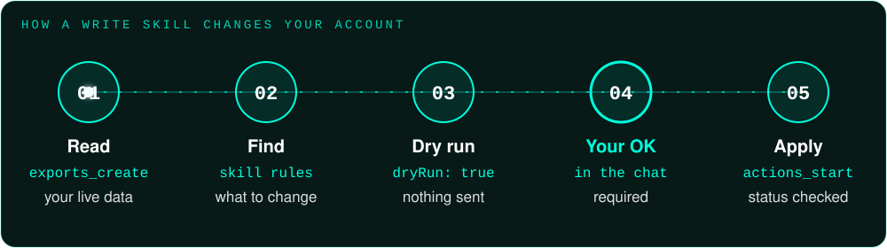

<div align="center">



# DataDoe AI Skills: Claude Skills for Amazon Sellers

**Open-source Agent Skills for Amazon sellers and vendors: PPC and Amazon Ads, profit, inventory, listings and account health.**<br/>
Each skill turns one prompt in Claude, ChatGPT, Cursor, Claude Code or Codex into a report, an alert, a dashboard or a working app.<br/>
They read your live Seller Central, Vendor Central and Amazon Ads data through the [DataDoe MCP server](https://github.com/Deltologic/datadoe-mcp).<br/>
Write skills preview every change with a dry run and change your account only after your OK.

<br/>

[](https://www.datadoe.com/hub/ai-agents-and-skills)
&nbsp;
[](https://www.datadoe.com/connect/amazon/mcp)

[](https://agentskills.io)
[](#how-to-use)
[](https://www.datadoe.com/)
[](#available-skills)
[](https://github.com/Deltologic/datadoe-mcp)
[](LICENSE)

<br/>


<br/>

🧠 [**All skills**](#available-skills) &nbsp;·&nbsp;
⚡ [Install](#installation-with-skills-cli) &nbsp;·&nbsp;
🛡️ [Write skills](#amazon-ppc-write-skills-preview-first-then-your-ok) &nbsp;·&nbsp;
🎥 [Videos](#watch-the-skills-run) &nbsp;·&nbsp;
🔌 [DataDoe MCP](https://github.com/Deltologic/datadoe-mcp) &nbsp;·&nbsp;
📘 [Hub](https://www.datadoe.com/hub/ai-agents-and-skills) &nbsp;·&nbsp;
❓ [FAQ](#frequently-asked-questions)


</div>

## Purpose

DataDoe AI Skills is a public library of reusable AI skills that take you from **one prompt to a working report, alert or prototype app** on your Amazon data.

Each skill is a practical blueprint in the open [Agent Skills](https://agentskills.io) format: a `SKILL.md` file with the steps, the DataDoe tables and the checks an AI agent follows. Most skills run in any MCP client (Claude, ChatGPT, Cursor, Claude Code, Codex) against the [DataDoe MCP server](https://github.com/Deltologic/datadoe-mcp); a few scaffold full apps through the DataDoe REST API. The **Interface** column in [Available Skills](#available-skills) tells you which each skill needs.

- Ready-made skill instructions for Amazon reports, alerts and DataDoe-powered apps.
- One standard way for AI agents to read DataDoe data and act on it safely.
- Less time from idea to the first working prototype.

## How To Use



1. Pick a skill from [Available Skills](#available-skills) or the `skills/` directory.
2. Install it with the [skills CLI](#installation-with-skills-cli), or open its `SKILL.md` file.
3. In your AI agent, ask for what the skill does, or point it at the skill by name.
4. Follow the setup steps it gives you (DataDoe MCP connection or API key, environment variables, run commands).
5. Run and iterate on the result.

The chat above is an example with made-up numbers.

### One-shot example prompt

```text
Build this app using @skills/create-orders-manager/SKILL.md.
Follow the skill exactly and generate a complete working implementation.
```

## Installation with skills CLI

[](https://skills.sh/deltologic/datadoe-ai-skills)

To install a selected skill from this repository, use the following command:

```bash
npx skills@latest add Deltologic/datadoe-ai-skills --skill SKILL_NAME
```

For example, the PPC wasted-spend report:

```bash
npx skills@latest add Deltologic/datadoe-ai-skills --skill ppc-wasted-spend-watchdog
```

> [!TIP]
> Every skill reads your data through DataDoe. Connect your Amazon accounts once at [datadoe.com](https://www.datadoe.com/connect/amazon/mcp) and add the DataDoe MCP server to your AI client ([setup guides](https://github.com/Deltologic/datadoe-mcp#step-by-step-guides-for-your-ai-tool)).

## Available Skills



<details>
<summary><b>Full skills table</b>: access, interface, output, what each skill builds and who it is for</summary>

**Access:** 🔍 **Read-only** - only reads your data, never changes anything on Amazon. ✍️ **Write (approval-gated)** - can change your account, but always previews with a dry run first and applies only on your explicit approval; you stay in full control.

**Interface:** 🔌 **MCP** - runs in any MCP client (Claude, ChatGPT, Cursor, Claude Code). 🧩 **API** - builds on the DataDoe REST API. 🔀 **Both** - MCP-first with a REST fallback.

**Output:** 📊 **Report** - analysis / an HTML card / a dashboard, delivered in your assistant. 🖥️ **App** - a runnable code project the skill scaffolds. ⚡ **Action** - an approval-gated change to your account.

| Skill | Access | Interface | Output | Category | What it builds | Best for |
| --- | --- | --- | --- | --- | --- | --- |
| `create-orders-manager` | 🔍 Read-only | 🧩 API | 🖥️ App | Reporting | A complete single-page Orders Manager app with seller/vendor picker, orders table with nested line items, filtering, local tagging, and robust DataDoe export/poll/download flow. | Teams that need a fast operational dashboard for order analysis and workflows. |
| `create-amazon-reconciliation-dashboard` | 🔍 Read-only | 🔀 Both | 📊 Report | Reporting | A self-contained interactive Amazon Reconciliation Dashboard with month switching, KPI cards, charts, a daily summary table, and an Order Explorer for reconciling Amazon orders against settlements. | Teams that need to compare Amazon orders and settlements across a 6-month window with clear cross-month reconciliation. |
| `weekly-sales-briefing` | 🔍 Read-only | 🔌 MCP | 📊 Report | Reporting | A polished interactive HTML weekly sales briefing card with KPI tiles, top 5 SKUs, biggest week-over-week drops, and concise AI-generated insights from DataDoe exports. | Sellers and operators who need a fast weekly performance recap with clear trend signals and SKU-level highlights. |
| `sales-movers-scanner` | 🔍 Read-only | 🔌 MCP | 📊 Report | Reporting | A catalog-wide scan of the biggest sales movers (up and down) that decomposes each move into its cause - traffic, conversion, price or buy-box - ranked by money, with a data-completeness guard so a lagging recent week isn't reported as a fake collapse, from DataDoe sales & traffic data. | Sellers who want a Monday-morning "what changed and why" list that's already diagnosed per SKU, not just a table of deltas. |
| `vendor-performance-dashboard` | 🔍 Read-only | 🔌 MCP | 📊 Report | Reporting | A live Vendor Central performance dashboard - KPI scorecards for vendor sales, ad spend, ad sales, ROAS and orders (last 30 days vs the previous 30, anchored on the newest vendor data), a daily sales and ad-spend trend, and an ASIN table with sales, ordered units, glance views and CVR - as a Cowork live artifact or an HTML file, from DataDoe. Offers an updated version with ordered revenue, TACoS, and lost Buy Box and out-of-stock rates per ASIN. | Vendors and agencies who want a quick, shareable view of the main 1P performance factors with one-click refresh. |
| `weekly-business-review` | 🔍 Read-only | 🔌 MCP | 📊 Report | Profit & Finance | An interactive weekly business-review card covering profit, margin, ad efficiency (TACoS) and inventory, comparing this week to a trailing 4-week baseline, with a cost-driver drill for any margin/fee anomaly and concrete next actions, from DataDoe data. | Sellers and operators who want a weekly profit and health review that explains what changed and why - not just sales. |
| `daily-account-health-check` | 🔍 Read-only | 🔌 MCP | 📊 Report | Account Health | A daily account-health check that scores AHR, order-defect rate, late-shipment, valid-tracking, cancellation and policy violations against Amazon's own targets, rolled up to a red/amber/green verdict with the exact issues to fix first, from DataDoe. | Sellers and operators who want a fast daily "is my account safe" smoke alarm that catches policy and performance risks before they escalate. |
| `daily-performance-health-check` | 🔍 Read-only | 🔌 MCP | 📊 Report | Account Health | A daily routine that posts yesterday's sales, orders, units, profit (before Amazon fees), ACoS, TACoS and ROI per marketplace on a 7-day trend to Slack (or email), with an ads check and the issues to look at first - with a completeness guard so a late data load isn't reported as a collapse, from DataDoe. Offers an updated version with the Amazon account-health verdict, the likely cause of each alert and a quiet mode. | Multi-marketplace sellers who want a morning alert when sales fall off a cliff or ads stop, without checking every marketplace by hand. |
| `ppc-wasted-spend-watchdog` | 🔍 Read-only | 🔌 MCP | 📊 Report | PPC & Ads | A Sponsored Products wasted-spend report that finds dead search terms (clicks, no orders) and bleeders (converting above your break-even ACoS), quantifies the money to reclaim, and routes them to the negative-keyword and bid-optimizer skills, from DataDoe. | Sellers and agencies who want a fast weekly PPC clean-up that pinpoints exactly which search terms to negate or cut bids on. |
| `ppc-campaign-acos-alert` | 🔍 Read-only | 🔌 MCP | 📊 Report | PPC & Ads | A daily ACoS alert for your top (or chosen) campaigns - month-to-date ad spend, ad sales and ACoS against your threshold, emailed every run with the campaigns over it first, from DataDoe Amazon Ads data. Offers an updated version that also flags campaigns whose ACoS is climbing and suggests the next step. | Sellers who want to hear the same day a key campaign's ACoS goes over target, set up in about a minute. |
| `ppc-asin-acos-alert` | 🔍 Read-only | 🔌 MCP | 📊 Report | PPC & Ads | A daily per-ASIN ACoS alert - each ASIN checked against its own threshold over the last 7 days, emailed as a worst-first table with how far over each one is, plus an in-chat drill into why an ASIN's ACoS is high, from DataDoe Amazon Ads data. Offers an updated version that suggests each threshold from the ASIN's break-even ACoS and adds product names. | Sellers whose products have different margins and need a different acceptable ACoS per ASIN. |
| `net-profit-pl-analyzer` | 🔍 Read-only | 🔌 MCP | 📊 Report | Profit & Finance | A true net-profit-by-SKU report - after Amazon fees, FBA, COGS and ad spend, not just sales - ranking the real profit winners and surfacing SKUs that are quietly losing money, from DataDoe. | Sellers and operators who want to know which products actually make money and where margin is leaking, not just top-line revenue. |
| `vendor-pnl-dashboard` | 🔍 Read-only | 🔌 MCP | 📊 Report | Profit & Finance | A Vendor Central P&L dashboard - shipped revenue, net revenue after ads, ad spend, ad revenue, TACoS, ACoS, ROAS and impressions with month-over-month badges, revenue and ad-efficiency charts, and a 12-month P&L statement - as a Cowork live artifact or an HTML file, from DataDoe. Offers an updated version with your true vendor margin (what Amazon pays you, co-op, margin after ads) and Net PPM. | Small and mid-size vendors who want a monthly P&L view without paying for an enterprise vendor tool. |
| `return-refund-analyzer` | 🔍 Read-only | 🔌 MCP | 📊 Report | Profit & Finance | Finds the product families and SKUs losing the most margin to returns and why they come back - the real reasons and the customers' own comments, bucketed into product, listing, sizing and delivery - ranked by money (not return rate) against the store's own return rate, one marketplace at a time, from DataDoe returns, sales and COGS data. | Sellers who want to cut returns where it pays: a money-ranked, reason-diagnosed list that says whether to fix the product, the listing, or the sizing. |
| `promotions-manager` | 🔍 Read-only | 🔌 MCP | 📊 Report | Profit & Finance | One view of every Amazon promotion - Best Deals, Lightning Deals, Price Discounts, standard / Subscribe & Save / Reorder coupons - with the live calendar and Amazon's own eligibility flags, what each event cost in deal and coupon fees against the sales and profit it added (measured against the products outside the deals; fees are Amazon's previews, marked as estimates until they show in settlements), the deals that did not earn back their own fee, and a rules pre-check (30-day lowest price, minimum discount, overlap, budget, stock, margin) for the next one, from DataDoe promotion, coupon, profit, settlement and listing data. | Sellers who run deals and coupons and want to know which ones paid off, what the next one will cost, and whether it will pass Amazon's rules - before they build it in Seller Central. |
| `restock-priority-alert` | 🔍 Read-only | 🔌 MCP | 📊 Report | Inventory | An FBA restock priority list per product - stock and inbound added up over all its SKUs, set against 30-day sales and your lead time - that ranks what is out of stock or will run out before a new shipment arrives, with how many units to ship and by when, next to Amazon's own recommended quantity. From DataDoe's FBA Inventory Health, with Amazon's restock recommendations as the fallback. | Sellers who want a fast weekly restock plan that catches stockouts before they cost sales, without over-ordering. |
| `fba-stock-restock-planner` | 🔍 Read-only | 🔀 Both | 📊 Report | Inventory | An Excel stock & restock planner for your top ASINs - 30-day sales, a 1.5x restock target, FBA available and inbound units, a yellow column for your own warehouse stock (from your ERP), and the gap with a Critical / Low / OK status - with live formulas and an optional daily refresh, from DataDoe. Offers an updated version with velocity, days of stock left, an order-by date and a lead-time restock target. | Sellers whose warehouse or purchasing team needs one sheet every morning that says which ASINs to order. |
| `fba-inventory-ledger-report` | 🔍 Read-only | 🔌 MCP | 📊 Report | Inventory | An Excel FBA inventory ledger per SKU across marketplaces - the full ledger per marketplace, every fulfillment-center event, inbound and FC-transfer quantities, and a consolidated per-SKU view - from DataDoe ledger and inventory data. Offers an updated version with a lost & damaged vs reimbursed sheet and a balance check. | European / multi-marketplace sellers who need to see where their units moved between fulfillment centers and countries. |
| `vendor-inventory-report` | 🔍 Read-only | 🔌 MCP | 📊 Report | Inventory | A Vendor Central inventory dashboard - sellable, unsellable, open PO, net received, aged 90+, sellable cost and unfilled orders with a Sellable vs Open PO chart and a sortable ASIN table (snapshots read from the latest date, never summed) - as a Cowork live artifact or an HTML file, from DataDoe. Offers an updated version with product names, weeks of cover and stockout / overstock flags. | Vendors who want a simple, accurate ASIN-level view of their 1P inventory to bring to the next vendor call. |
| `buy-box-loss-root-cause` | 🔍 Read-only | 🔌 MCP | 📊 Report | Listings & Content | A Buy Box diagnosis that finds SKUs losing the Featured Offer and the likely cause (priced out, out of stock, or fulfilment) so you can win it back, from DataDoe buy-box and price data. | Sellers who see sales drop while traffic holds and need to know why they lost the Buy Box and exactly what to fix. |
| `amazon-listing-optimizer` | 🔍 Read-only | 🔌 MCP | 📊 Report | Listings & Content | A 2026-ready listing audit that first checks whether the listing is the cause at all (Buy Box, stock and price, a swap with another of your products, fewer searches), then benchmarks your search funnel against the market (impressions, clicks, cart-adds, purchases), separates an exposure problem from a copy problem, checks the title against the 75-char cap and COSMO/Rufus intent coverage, and returns an upload-ready title, bullets, backend terms and attribute fixes, from DataDoe SQP, catalog and listing data. | Sellers and agencies who want a data-driven listing rewrite that says exactly what to fix first and why, aligned with Amazon's latest title, ranking and AI-search rules. |
| `suppressed-inactive-listings-check` | 🔍 Read-only | 🔌 MCP | 📊 Report | Listings & Content | A catalog-wide scan for listings that are silently not selling - suppressed, inactive, stranded (stock on hand but not buyable), or carrying an error/quality issue - ranked by the revenue at risk so you fix the costly ones first, from DataDoe listing status, issues, offer, inventory and sales data. | Sellers who want a fast weekly "is anything broken right now" sweep that surfaces the few blocked listings actually costing sales, not a wall of dead SKUs. |
| `ppc-negative-keyword-applier` | ✍️ Write (approval-gated) | 🔌 MCP | ⚡ Action | PPC & Ads | Finds the exact Sponsored Products search terms burning budget with no sales and adds them as negative keywords through DataDoe Actions - a dryRun preview first, a real change only on your approval - so you stop paying for clicks that never convert. | Sellers and agencies who want to act on wasted PPC spend, not just see it: turn dead search terms into negatives safely, from chat. |
| `ppc-bid-optimizer-apply` | ✍️ Write (approval-gated) | 🔌 MCP | ⚡ Action | PPC & Ads | Recomputes Sponsored Products keyword bids toward a target ACoS and applies them through DataDoe Actions - dryRun preview first, real change only on your approval - cutting bids on bleeders and nudging up profitable keywords. | Sellers and agencies who want weekly bid tuning that actually writes the changes back to Amazon, safely and one step at a time. |
| `ppc-profit-bid-apply` | ✍️ Write (approval-gated) | 🔌 MCP | ⚡ Action | PPC & Ads | Sets Sponsored Products keyword bids from each product's profit and the keyword's conversion, then applies them through DataDoe Actions - a dryRun preview first, a real change only on your approval. The bid is sales per click times a target ACoS. | Sellers who want one before-and-after bid table based on real fees, product cost, and how well each keyword converts. |
| `amazon-asin-search-auditor` | 🔍 Read-only | 🔌 MCP | 📊 Report | Search & SEO | A dashboard report that audits an Amazon seller's organic and sponsored search visibility using DataDoe search-term data, live search results, owned-ASIN matching, and screenshots. | Teams that need to run a search-visibility audit for a specific seller to identify ASIN/rank gaps and understand organic vs. sponsored placement. |
| `keyword-rank-sqp-tracker` | 🔍 Read-only | 🔌 MCP | 📊 Report | Search & SEO | A week-over-week tracker of search share on the keywords you sell on, for the whole store or one product, using impression, click and purchase shares. It checks the cause of each drop (fewer searches, a swap between your own products, stock / Buy Box / price) before calling it a loss, keeps Search Query Score as context, and degrades to a baseline on accounts with little SQP history, from DataDoe weekly Search Query Performance. | Sellers who want an ongoing watch on search-share changes for the keywords that matter, with a short list ordered by purchases lost and the cause of each drop; SQP does not measure organic search position. |

</details>

## Amazon PPC write skills: preview first, then your OK



Three skills change your Amazon Ads account: `ppc-negative-keyword-applier`, `ppc-bid-optimizer-apply` and `ppc-profit-bid-apply`. Every other skill only reads.

> [!IMPORTANT]
> A write skill always runs a `dryRun` first and shows you every change. Nothing reaches Amazon until you approve it in the chat.

Action skills use `actions_start` for Amazon lookups, write dry runs, and approved changes. All MCP clients use the standard `/mcp/v1` endpoint. Use `actions_details_schema_get` to check whether an Action reads or writes Amazon data; its `access` field reports `READ` or `WRITE`. A read Action, including Amazon Ads FIND, runs on a Seller or Vendor with Read only or Read and write access. A live write Action needs Read and write. A dry run still validates a write Action on a Read only account and does not queue it.

## Watch the skills run

<table>
<tr>
<td width="33%" valign="top"><a href="https://www.youtube.com/watch?v=mOCjbfS7c14"></a><br/><sub><b>Live Amazon Vendor Central Dashboard</b><br/><code>vendor-performance-dashboard</code></sub></td>
<td width="33%" valign="top"><a href="https://www.youtube.com/watch?v=Bfl4OCux3B0"></a><br/><sub><b>Amazon Vendor P&amp;L Dashboard</b><br/><code>vendor-pnl-dashboard</code></sub></td>
<td width="33%" valign="top"><a href="https://www.youtube.com/watch?v=6B1CaoMAxtw"></a><br/><sub><b>Vendor Central Inventory Report</b><br/><code>vendor-inventory-report</code></sub></td>
</tr>
<tr>
<td valign="top"><a href="https://www.youtube.com/watch?v=nQSSBho-MSs"></a><br/><sub><b>Amazon PPC Campaign Alerts</b><br/><code>ppc-campaign-acos-alert</code></sub></td>
<td valign="top"><a href="https://www.youtube.com/watch?v=XY955bci5x4"></a><br/><sub><b>Amazon PPC Monitoring per ASIN</b><br/><code>ppc-asin-acos-alert</code></sub></td>
<td valign="top"><a href="https://www.youtube.com/watch?v=2-zIMOAQj84"></a><br/><sub><b>Daily Amazon Health Check on Slack</b><br/><code>daily-performance-health-check</code></sub></td>
</tr>
<tr>
<td valign="top"><a href="https://www.youtube.com/watch?v=O_xJgozvrEc"></a><br/><sub><b>FBA Restock Planning Dashboard</b><br/><code>fba-stock-restock-planner</code></sub></td>
<td valign="top"><a href="https://www.youtube.com/watch?v=gsxAi79N4y8"></a><br/><sub><b>FBA Inventory Ledger Dashboard</b><br/><code>fba-inventory-ledger-report</code></sub></td>
<td valign="top"><a href="https://www.youtube.com/watch?v=nJ6nsem-erY"></a><br/><sub><b>Amazon Reconciliation Dashboard</b><br/><code>create-amazon-reconciliation-dashboard</code></sub></td>
</tr>
</table>

More on the [DataDoe YouTube channel](https://www.youtube.com/@datadoe).

## Frequently asked questions

### Are there Claude Skills for Amazon sellers?

Yes. This repository holds Claude Skills for Amazon Seller Central, Vendor Central and Amazon Ads: PPC reports and bid changes, profit and P&L, inventory and restock, listings, Buy Box, search query performance and account health. They work in Claude, Claude Code and Claude Cowork, and in other AI agents that read the Agent Skills format.

### Is there a Claude skill for Amazon PPC?

Yes, six. Three read your Amazon Ads data: `ppc-wasted-spend-watchdog` (search terms that spend without sales), `ppc-campaign-acos-alert` and `ppc-asin-acos-alert` (daily ACoS alerts). Three change your account after a dry run and your OK: `ppc-negative-keyword-applier`, `ppc-bid-optimizer-apply` and `ppc-profit-bid-apply`.

### What is an AI skill (Agent Skill)?

A skill is a folder with a `SKILL.md` file: instructions, the data to read and the checks to run, which an AI agent loads when your request matches it. This repository uses the open [Agent Skills](https://agentskills.io) format, so one skill works in several AI tools.

### Do the skills work in ChatGPT, Cursor and Codex?

Yes. Skills marked 🔌 MCP or 🔀 Both run in any AI client connected to the [DataDoe MCP server](https://github.com/Deltologic/datadoe-mcp). In Claude Code, Cursor and Codex, install them with the [skills CLI](#installation-with-skills-cli). In ChatGPT or Claude.ai, attach the skill's `SKILL.md` to your chat.

### Can a skill change my Amazon account?

Only the three write skills in [Write skills](#amazon-ppc-write-skills-preview-first-then-your-ok), and only after your OK. Each one runs a dry run first and shows every change. All other skills only read.

### Do I need an Amazon SP-API developer account?

No. DataDoe connects your Seller Central, Vendor Central and Amazon Ads accounts and handles the Amazon APIs for you. The skills read the data through DataDoe.

### Are the skills free?

The skills are open source under the MIT license. They run on your data in DataDoe, which has a [14-day free trial](https://www.datadoe.com/connect/amazon/mcp); see [DataDoe pricing](https://www.datadoe.com/hub/docs/basics/subscription-pricing).

### Can I write my own skill?

Yes. Copy a skill folder, change its `SKILL.md`, and keep the rules in [About this repository](#about-this-repository) so the checks pass.

## About this repository

| Path | What |
| --- | --- |
| `skills/<name>/SKILL.md` | One skill. Some skills also carry `references/` and `scripts/`. |
| `tests/validate-skills.ts` | Checks every skill's frontmatter and that the skills table in this README matches the `skills/` folders. |
| `tests/validate-scheme.ts` | Checks that every `amazon_*` table or column a skill names exists in the [DataDoe data scheme](https://api.datadoe.com/api/v1/spec/data-scheme) and is not deprecated. |
| `.github/readme/` | The images in this README. `build.py` draws them and counts every number from `skills/`. |

Rules for a new or changed skill:

- The folder name equals `name` in the frontmatter, shorter than 64 characters.
- `metadata` has `author: DataDoe`, `check-more-skills-at: https://app.datadoe.com/hub/ai-agents-and-skills`, a `category` (Reporting, Profit & Finance, Account Health, PPC & Ads, Inventory, Listings & Content, Search & SEO), `access` (read, write), `interface` (mcp, api, both) and `output` (report, app, action).
- Optional: `metadata.title` (the name the images show; the folder name otherwise) and `metadata.youtube-video-embed-url` (must start with `https://www.youtube.com/embed/`).
- The skill has one row in the [Available Skills](#available-skills) table; its first cell is the skill name.
- Run `yarn test`, then `python3 .github/readme/build.py` so the images show the new counts (Python 3.9+, no packages).

## External Links

- [DataDoe AI Agents & Skills (Hub)](https://app.datadoe.com/hub/ai-agents-and-skills)
- [DataDoe MCP server on GitHub](https://github.com/Deltologic/datadoe-mcp)
- [DataDoe MCP overview](https://app.datadoe.com/hub/docs/datadoe-mcp/overview)
- [DataDoe Data Scheme browser](https://app.datadoe.com/hub/data-scheme)
- [DataDoe Documentation](https://app.datadoe.com/hub/docs)
- [DataDoe API Documentation](https://api.datadoe.com/api/v1/docs)
- [DataDoe Data Scheme Reference](https://api.datadoe.com/api/v1/spec/data-scheme)

## Contact

For questions, feedback, or collaboration requests, email: [contact@datadoe.com](mailto:contact@datadoe.com)

## License

[MIT](LICENSE)

<div align="center">

</div>
